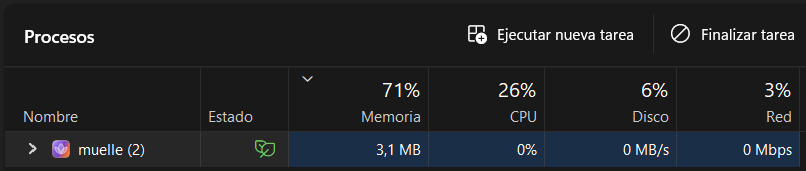

<div align="center">
  


  **A lightweight, macOS-inspired dock for Windows 11.**

  Muelle replaces the Windows taskbar with a customizable dock and an optional
  macOS-style menu bar.

</div>


Smooth magnification, live window previews, and an optional Genie-style minimize effect.

| Auto-hiding Dock and Menu Bar | Genie Effect on Minimize |
|---|---|
|  |  |

## Features

- Glass-style dock with smooth, cursor-based icon magnification.
- Launch, pin, reorder, and manage apps, including recent apps and open windows.
- Live minimized-window previews.
- Click the app already in front to minimize it, as on the Windows taskbar.
- Drag and drop files onto apps, Downloads, or the Recycle Bin.
- Optional auto-hide.
- A top menu bar with the app in front, clock, network, volume and battery, plus
  the Search, Task View and Widgets buttons if you have them on the Windows taskbar.
- Separate Settings app with live changes, Spanish and English, and a
  configurable Genie-style minimize animation.
- A watchdog restores the Windows taskbar if the dock exits unexpectedly.

The Genie effect is **on by default** and can be turned off in Settings → Dock.
While enabled, Muelle temporarily disables Windows window transitions for
tracked windows so its minimize animation can run; those transitions are
restored when Muelle exits.

## Install

**[Download Muelle-Setup.exe](https://github.com/crafter-station/Muelle/releases/latest/download/Muelle-Setup.exe)**
(Windows 11, 64-bit) or pick a version from
[Releases](https://github.com/crafter-station/Muelle/releases).

1. Run `Muelle-Setup.exe`. It installs for your user only: no administrator
   rights, no wizard, about two seconds.
2. The installer is not code-signed yet, so Windows SmartScreen may say it
   protected your PC. Choose **More info → Run anyway**.
3. Open **Muelle** from the Start menu, then choose **Dock** to
   personalize the dock and top menu bar.

You can also open Settings by right-clicking the dock and choosing *Muelle
Settings…*. It checks for updates and installs them for you.

**Get the taskbar back:** right-click the dock and choose *Quit Muelle*. To
remove it completely, go to Windows Settings → Apps → Installed apps → Muelle →
Uninstall; the taskbar comes back and nothing is left running.

## Resource usage

In one idle snapshot, Windows Task Manager showed **3.1 MB** for the grouped
`muelle (2)` processes. This point-in-time reading can vary by machine and
session; it excludes Settings and its WebView2 runtime.



## Try it on Windows

### Prerequisites

- Windows 11
- Rust with the MSVC toolchain and Visual Studio C++ Build Tools
- Node.js and pnpm

### Run the dock

From the repository root:

```powershell
cargo run -p muelle
```

The dock hides the taskbar while it is running. Press **Ctrl+C** in the
terminal to exit; Muelle should restore the taskbar automatically. If you need
to restore it manually:

```powershell
cargo run -p muelle -- --restore
```

### Run Settings

Keep the dock running, open a second terminal, and run:

```powershell
cd apps\settings
pnpm install
pnpm tauri dev
```

This opens the native Settings window. Frontend changes hot-reload; after
changing the Rust backend, restart `tauri dev`. Settings changes are applied to
the running dock.

## Build and test

From the repository root:

```powershell
cargo fmt --all -- --check
cargo test --workspace --locked
```

To build the Settings frontend:

```powershell
cd apps\settings
pnpm build
```

## Project layout

| Path | Purpose |
|---|---|
| `apps/dock` | Native Windows dock |
| `apps/settings` | Tauri desktop settings app |
| `crates/muelle-core` | Platform-independent layout and animation logic |
| `crates/muelle-shell` | Windows shell integration |
| `crates/muelle-config` | Shared settings and persistence |
| `plan.md` | Development plan and implementation notes (Spanish) |

## Build the installer

```powershell
cd apps\settings
pnpm install
cd ..\..
.\scripts\build-installer.ps1
```

The script builds both apps and produces `Muelle_<version>_x64-setup.exe` in
`target\release\bundle\nsis`. The installer runs per user, needs no
administrator rights and shows no wizard: it installs to
`%LOCALAPPDATA%\Programs\Muelle`, turns on start with Windows and opens the dock.
Uninstalling (Settings → Apps) quits the dock and gives the Windows taskbar back.

Pushing a tag that matches the version (for example `v0.1.1`) builds the
installer on GitHub Actions and attaches it to a draft release, together with
`Muelle-Setup.exe` (the website's download link), `latest.json` (read by the
updater in Settings) and that version's notes from `CHANGELOG.md`. The repository needs the secrets
`TAURI_SIGNING_PRIVATE_KEY` and `TAURI_SIGNING_PRIVATE_KEY_PASSWORD`. Publish the
draft to make it the download and the update.

## Current status

The dock, Settings app and installer work on Windows 11. Some features and
interactions are still being verified. The installer is not code-signed yet, so
Windows SmartScreen warns before running it (More info → Run anyway).
