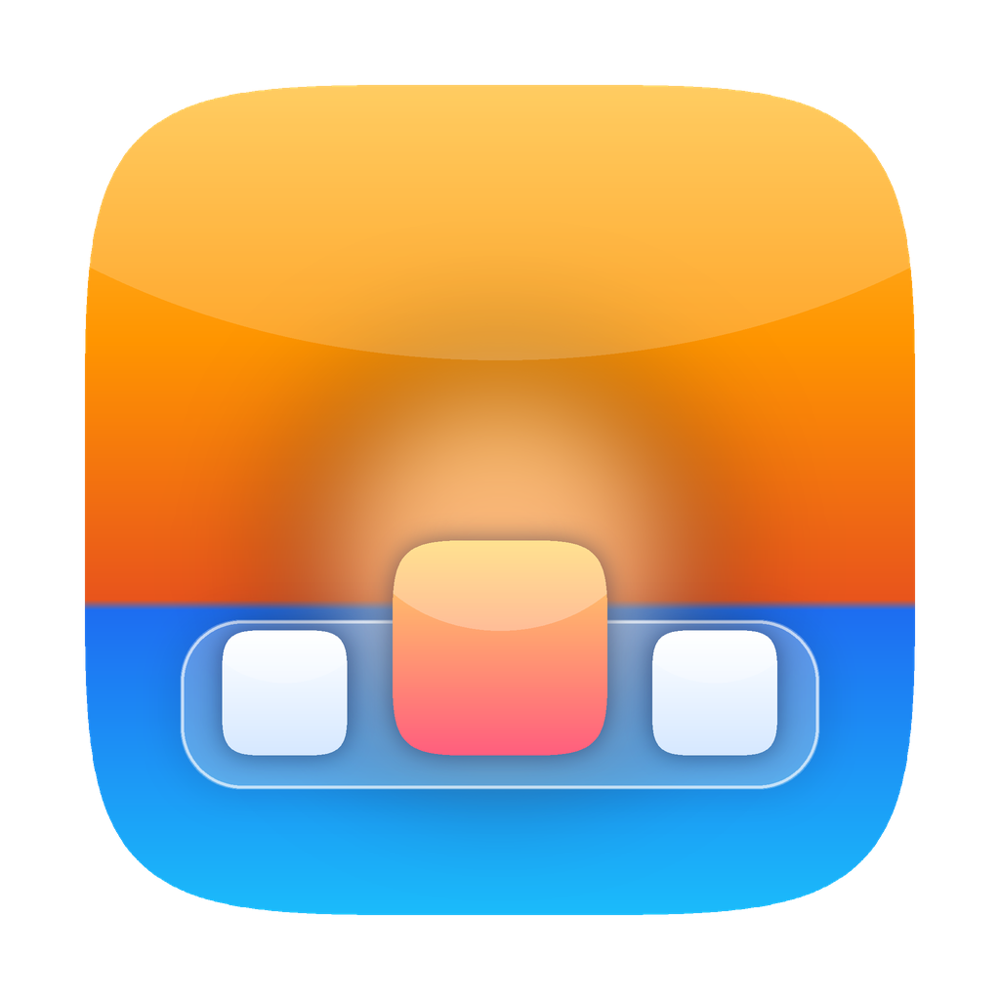

<div align="center">
  

  # Muelle

  **A lightweight, macOS-inspired dock for Windows 11.**

  Smooth magnification, live window previews, and an optional Genie-style minimize effect.

  
  
  
  
</div>

Muelle replaces the Windows taskbar with a customizable dock and an optional
macOS-style menu bar. It is built for Windows 11 and is still under active
development.

## Features

- Glass-style dock with smooth, cursor-based icon magnification.
- Launch, pin, reorder, and manage apps, including recent apps and open windows.
- Live minimized-window previews.
- Drag and drop files onto apps, Downloads, or the Recycle Bin.
- Optional auto-hide and a top menu bar with the clock and system shortcuts.
- Separate Settings app with live changes, Spanish and English, and a
  configurable Genie-style minimize animation.
- A watchdog restores the Windows taskbar if the dock exits unexpectedly.

The Genie effect is **off by default**. When enabled, Muelle temporarily
disables Windows window transitions for tracked windows so its minimize
animation can run; those transitions are restored when Muelle exits.

## Try it on Windows

### Prerequisites

- Windows 11
- Rust with the MSVC toolchain and Visual Studio C++ Build Tools
- Node.js and pnpm

### Run the dock

From the repository root:

```powershell
cargo run -p muelle
```

The dock hides the taskbar while it is running. Press **Ctrl+C** in the
terminal to exit; Muelle should restore the taskbar automatically. If you need
to restore it manually:

```powershell
cargo run -p muelle -- --restore
```

### Run Settings

Keep the dock running, open a second terminal, and run:

```powershell
cd apps\settings
pnpm install
pnpm tauri dev
```

This opens the native Settings window. Frontend changes hot-reload; after
changing the Rust backend, restart `tauri dev`. Settings changes are applied to
the running dock.

## Build and test

From the repository root:

```powershell
cargo fmt --all -- --check
cargo test --workspace --locked
```

To build the Settings frontend:

```powershell
cd apps\settings
pnpm build
```

## Project layout

| Path | Purpose |
|---|---|
| `apps/dock` | Native Windows dock |
| `apps/settings` | Tauri desktop settings app |
| `crates/muelle-core` | Platform-independent layout and animation logic |
| `crates/muelle-shell` | Windows shell integration |
| `crates/muelle-config` | Shared settings and persistence |
| `plan.md` | Development plan and implementation notes (Spanish) |

## Current status

The dock and Settings app can be run from source. Some features and interactions
are still being verified, and a packaged installer is not available yet. See
